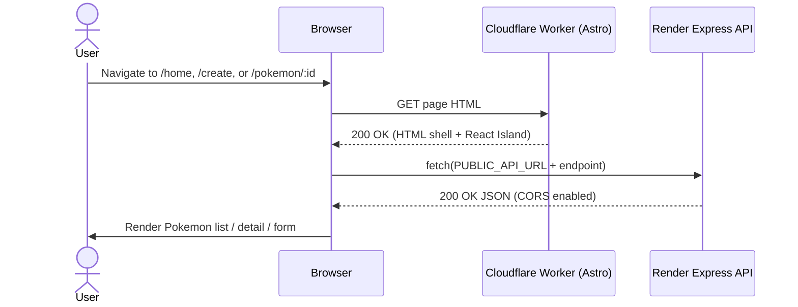

# Spec: Client-Side API Fetching (Eliminating Worker-to-Render 429s)

## Context & Problem Statement

When Astro SSR pages (`home.astro`, `create.astro`, `pokemon/[id].astro`) run on Cloudflare Workers (`pokeapp-client.mstefanutti24-cf.workers.dev`) and `fetch()` the Express API hosted on Render (`https://pokeapp-api-l7n2.onrender.com`), Render's Cloudflare edge proxy immediately rejects the requests with `429 Too Many Requests` (`server: cloudflare`, `cf-ray: ...-EZE`).

Direct browser requests to the same Render endpoints return `200 OK` (and the API already configures `Access-Control-Allow-Origin: *` while `client/src/middleware.ts` already allows `connect-src 'self' https: http://localhost:*`). Furthermore, Cloudflare's `caches.default` API is a no-op on `*.workers.dev` subdomains, and Render free-tier cold starts (15–30s) cause SSR pages to hang or time out.

## Goals

1. **Eliminate all Cloudflare Worker → Render `fetch()` calls** by moving `/pokemons` and `/types` data fetching to browser-hydrated React islands (`client:load`).
2. **Preserve dynamic routing** (`/pokemon/[id]` and URL search-parameter filtering/sorting/pagination on `/home`) by keeping Astro's server adapter without server-side API calls.
3. **Improve UX during Render cold starts** by displaying a loading indicator (`/resources/loading.gif`) while data is fetched in the browser.
4. **Simplify the codebase** by removing `client/src/lib/ssrApi.ts` and `client/src/lib/ssrApi.test.ts` and replacing them with a minimal `client/src/lib/api.ts` helper.

## Architecture

## Component & Hydration Plan

- **`client/src/lib/api.ts`**:
  - `getApiBase()`: Returns `import.meta.env.PUBLIC_API_URL || 'http://localhost:3002'`.
- **`client/src/components/PokemonHome.tsx`** (`client:load` in `home.astro`):
  - Receives URL query parameters (`page`, `type`, `sort`, `personalized`, `search`, `currentSearch`) as props.
  - Fetches `${apiBase}/types` and `${apiBase}/pokemons?limit=1000` in parallel via `useEffect`.
  - Shows a loading state using `/resources/loading.gif` (`Pokemons.module.css` `.loadingImg`), an error banner on failure, or the filtered/sorted/paginated `PokemonCard` grid + `SearchBar` + `Pagination`.
- **`client/src/components/CreatePokemon.tsx`** (`client:load` in `create.astro`):
  - Accepts optional `types` prop; when omitted, fetches `${apiBase}/types` on mount and surfaces any fetch error in an error banner.
- **`client/src/components/PokemonDetailView.tsx`** (`client:load` in `pokemon/[id].astro`):
  - Receives `id` prop, fetches `${apiBase}/pokemons/${id}` on mount, displays a loading state, renders presentational `<PokemonDetail />`, or shows an error state with a link back to `/home`.
- **Cleanup**:
  - Remove `client/src/lib/ssrApi.ts` and `client/src/lib/ssrApi.test.ts`.

## Verification Plan

- Unit tests via `pnpm --dir client test -- --run` (covering `PokemonHome`, `PokemonDetailView`, and existing `PokemonDetail`).
- Type checking via `pnpm --dir client run typecheck`.
- Production build via `pnpm --dir client run build`.
