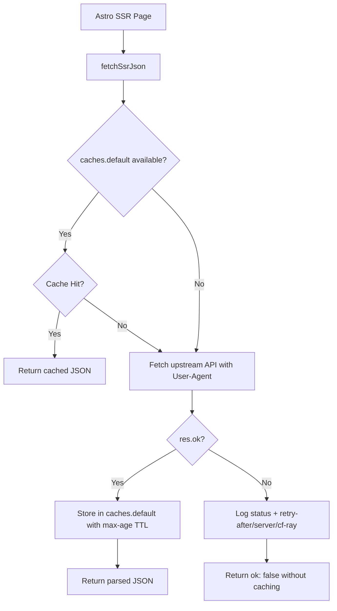

# Spec: SSR API Caching, Headers, and 429 Diagnostics

## Context & Problem Statement

In production on Cloudflare Workers (`pokeapp-client`), Astro SSR pages (`home.astro`, `create.astro`, `pokemon/[id].astro`) perform uncached `fetch()` calls to the Render-hosted backend (`https://pokeapp-api-l7n2.onrender.com`) on every incoming page request.

Logs from Cloudflare Workers showed `429 Too Many Requests` responses returning in ~4 ms from the `EZE` edge PoP for both `/types` and `/pokemons?limit=1000`. Because the Express backend has no rate-limiting middleware, these `429` responses originate at Render's Cloudflare edge proxy when receiving repeated, uncached Worker egress requests.

## Goals

1. **Reduce outbound SSR requests to Render** by caching successful `200 OK` JSON responses in Cloudflare's Cache API (`caches.default`) with endpoint-appropriate TTLs.
2. **Identify SSR traffic cleanly** by attaching `User-Agent: PokeApp-SSR/1.0` and `Accept: application/json` headers to all SSR `fetch()` calls.
3. **Improve 429 observability** by logging `retry-after`, `server`, and `cf-ray` response headers on failed SSR fetches.
4. **Parallelize independent SSR fetches** in `home.astro` using `Promise.all`.
5. **Preserve local Node/Astro dev compatibility** by gracefully bypassing `caches.default` when the Cloudflare Cache API is unavailable.

## Architecture

## Implementation Details

- **Helper Module (`client/src/lib/ssrApi.ts`)**:
  - `resolveApiBase()`: Resolves `PUBLIC_API_URL`, `API_URL`, `process.env.API_URL`, or falls back to `http://localhost:3002`.
  - `fetchSsrJson<T>(url, options)`:
    - Checks `caches.default.match(cacheKey)` when `ttlSeconds > 0` and `caches?.default` exists.
    - Fetches with `headers: { Accept: 'application/json', 'User-Agent': 'PokeApp-SSR/1.0' }`.
    - On `res.ok`, clones the JSON payload into a new `Response` with `Cache-Control: public, max-age=${ttlSeconds}` and stores it via `cache.put(cacheKey, ...)`.
    - On non-OK responses, logs status and `retry-after`, `server`, `cf-ray` headers, and skips caching.
- **Page Integrations**:
  - `client/src/pages/home.astro`: Fetch `/types` (`ttlSeconds: 3600`) and `/pokemons?limit=1000` (`ttlSeconds: 300`) concurrently via `Promise.all`.
  - `client/src/pages/create.astro`: Fetch `/types` (`ttlSeconds: 3600`).
  - `client/src/pages/pokemon/[id].astro`: Fetch `/pokemons/${id}` (`ttlSeconds: 300`).

## Verification Plan

- Unit tests in `client/src/lib/ssrApi.test.ts` executed via `pnpm test -- --run`.
- Type checking via `pnpm run typecheck`.
- Production Astro/Cloudflare build via `pnpm run build`.
